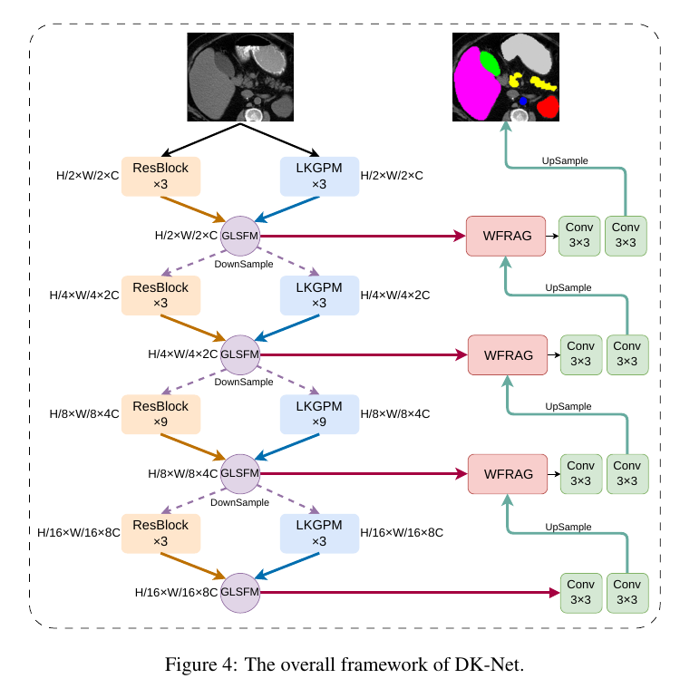

# DK-Net

PyTorch implementation of **DK-Net**, a dual-kernel network for 2-D medical image segmentation. The release contains a clean, self-contained model implementation and runnable training/evaluation pipelines for Synapse multi-organ CT and TN3K thyroid-nodule ultrasound segmentation.



The dual-branch encoder combines local residual blocks with Large-Kernel Global Perception Modules (LKGPM). Global-Local Synergistic Fusion Modules (GLSFM) exchange information between branches at each encoder stage, and Wide-Field Residual Attention Gates (WFRAG) are used in the decoder.

## Contents

```text
github_network/
├── assets/dknet_architecture.png   # Model overview used in this README
├── dknet/
│   ├── model.py                    # DKNet definition
│   ├── losses.py                   # CE/Dice helpers and target-class weights
│   ├── metrics.py                  # Dice, Jaccard, and HD95
│   └── data/                       # Synapse and TN3K dataset adapters
├── lists/synapse/                  # Official Synapse split lists
├── train_synapse.py
├── test_synapse.py
├── train_tn3k.py
├── test_tn3k.py
```

Datasets, checkpoints, TensorBoard logs, and prior experiment outputs are deliberately excluded from this repository. The dataset licenses and their original access conditions remain applicable.

## Environment

Python 3.8+ and PyTorch 1.13+ are required. Create an environment, install the PyTorch build appropriate for your CUDA driver from [pytorch.org](https://pytorch.org), then install the remaining packages:

```bash
conda create -n dknet python=3.8 -y
conda activate dknet
pip install -r requirements.txt
```

## Model API

```python
import torch
from dknet import DKNet

model = DKNet(num_classes=9)
logits = model(torch.randn(2, 1, 224, 224))
```

DK-Net accepts one-channel or three-channel 2-D images. Height and width must be divisible by 16.

## Synapse CT

### Expected layout

```text
data/
└── Synapse/
    ├── train_npz/
    │   └── caseXXXX_sliceYYY.npz   # keys: image, label
    └── test_vol_h5/
        └── caseXXXX.npy.h5         # datasets: image, label
```

The bundled list files correspond to the standard Synapse split. Labels use the following class indices: background `0`, aorta `1`, gallbladder `2`, left kidney `3`, right kidney `4`, liver `5`, pancreas `6`, spleen `7`, and stomach `8`.

### Training

The default objective is the paper configuration, `0.4 * CE + 0.6 * Dice`.

```bash
python train_synapse.py
```

### Evaluation

```bash
python test_synapse.py
```

The evaluator writes overall metrics, per-case metrics, and per-organ Dice/HD95 to the output directory. Use `--save-predictions` to store compressed volume predictions. For checkpoints evaluated with the earlier project's `(x - 0.5) / 0.5` input preprocessing, add `--normalize-input`.

## TN3K Ultrasound

### Expected layout

```text
data/
└── tn3k/
    ├── trainval-image/             # 0001.jpg, ...
    ├── trainval-mask/              # 0001.jpg, ...
    ├── test-image/                 # 0001.jpg, ...
    ├── test-mask/                  # 0001.jpg, ...
    └── tn3k-trainval-fold0.json ... tn3k-trainval-fold4.json
```

The image/mask pairing and fold JSON files follow the TN3K release. Masks are converted to binary labels internally.

```bash
python train_tn3k.py
python test_tn3k.py
```

All paths are optional command-line arguments. For example, an external Synapse location can be supplied without editing source code: `python train_synapse.py --data-root D:\\datasets\\Synapse\\train_npz`.

## Reported Reference Results

The final manuscript reports the following DK-Net results. Values can differ modestly with hardware, PyTorch/CUDA versions, data preprocessing, and random seeds.

| Dataset | Metric | Result |
| --- | --- | ---: |
| Synapse | Mean Dice | 84.73% |
| Synapse | Mean HD95 | 10.98 |
| TN3K | Dice | 75.84% |
| TN3K | HD95 | 29.59 |

## Reproducibility Notes

- Set `--seed` to control Python, NumPy, and PyTorch random states. The default is `3407`.
- The Synapse script uses a polynomial learning-rate schedule, SGD, momentum `0.9`, and weight decay `1e-4` by default.
- Training scripts select CUDA automatically when it is available and otherwise run on CPU. CPU training is supported but substantially slower.
- Checkpoints contain the model state, optimizer state, epoch, and command-line configuration.

## Citation


